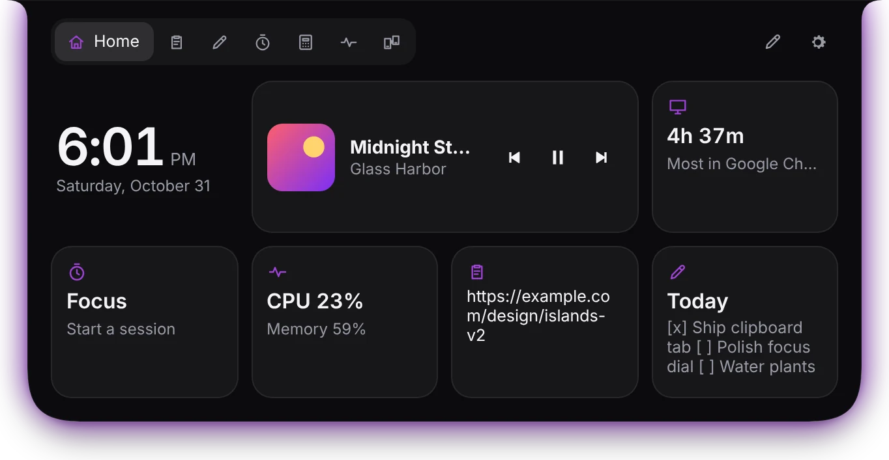
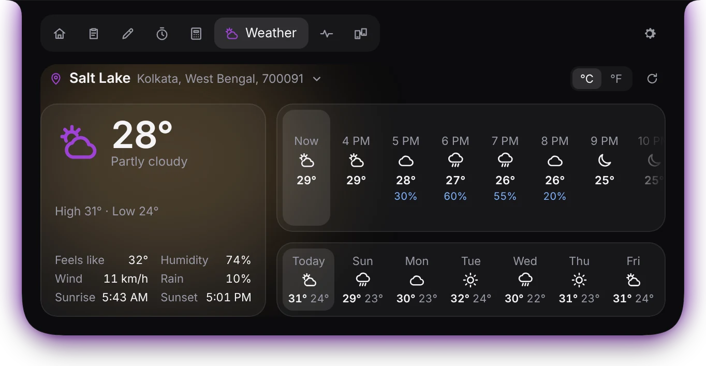
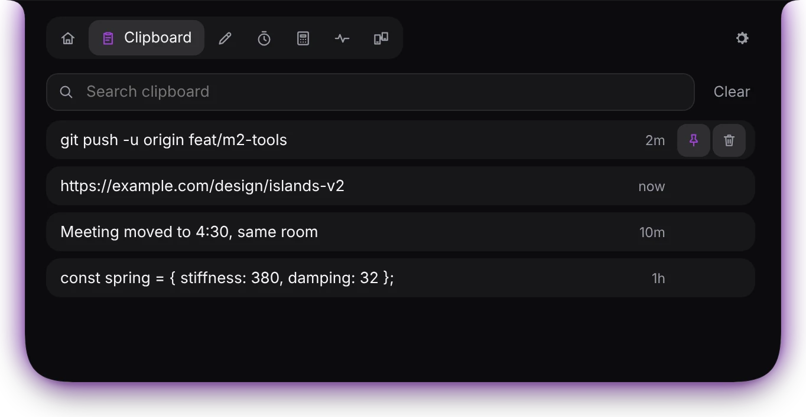

# Notcher

**A living island at the top of your Windows screen.** Music, clipboard history, notes, timers, weather, a unit converter and system stats are one hover away, and Notcher Drop moves files between your phone and PC with a QR code. Built for Windows 10 and 11.

**[Download Notcher for Windows](https://github.com/dipanjanbanerjee/notcher/releases/latest/download/Notcher-Setup.exe)** · [Website](https://dipanjanbanerjee.github.io/notcher/) · [All releases](https://github.com/dipanjanbanerjee/notcher/releases)

Latest version: **1.1.0** ([what's new](docs/releases/v1.1.0.md))

## Screenshots

<!-- Replace with fresh captures of 1.1.0 (resting clock, Home, Drop, Weather). -->

| Home | Weather | Clipboard |
| --- | --- | --- |
|  |  |  |

## Install

1. Download [Notcher-Setup.exe](https://github.com/dipanjanbanerjee/notcher/releases/latest/download/Notcher-Setup.exe) and run it. No administrator rights are needed; it installs for your account only.
2. Notcher starts at the top of your screen and sits in the tray. Right-click the tray icon for Settings and Quit.
3. Updates install themselves when Notcher starts (Settings › Updates lets you check by hand or turn this off). Each update replaces the installed copy in place, and your data is kept.

An `.msi` package is also published with each release, for managed PCs. It installs for all users and asks for administrator rights. Use either the Setup.exe or the .msi, not both.

## Features

### The island

- **Resting:** a slim notch with the date and a clock with seconds (12-hour or 24-hour), set in the Ubuntu typeface with no glow, so it stays clean on every theme.
- **Open:** hover and it springs open into the full panel. Short pop-ups (a new song, a finished timer, a notification) come out of the notch and fold back by themselves. Every animation can be interrupted, and reduced-motion settings are respected.
- **Click-through:** only the island takes the mouse; everything around it clicks straight through to your apps. While a mouse button is held (moving a window, selecting text), hovering doesn't open it.
- **Steps aside:** over a full-screen or maximized app it tucks into a thin tab at the top edge. Hover the tab to bring it back.
- **Glow:** a soft light around the island tinted from the album art, plus a *beat glow* under its edge that pulses with what's playing (read from the Windows volume meter; nothing is recorded).
- **Multi-monitor:** the island follows the screen your cursor is on.
- **Shortcut:** `Ctrl+Alt+Space` opens and closes it from anywhere (you can change it).
- **Themes:** Obsidian, Daylight, Neon and Paper.

### Eight tabs (`Ctrl+1` to `Ctrl+8`)

- **Home:** clock, music controls, today's screen time, and quick looks at your timer, system, last copy and latest note. Press the pen button to drag widgets around, remove them or add more.
- **Clipboard:** the last 200 things you copied, text and images, with search and pinning. Click one to copy it again. Passwords from password managers are never saved.
- **Notes:** quick notes that save as you type, with `[ ]` checklists and pinning.
- **Focus:** Pomodoro, countdown and stopwatch. The time stays visible on the resting island.
- **Convert:** length, weight, temperature, volume, area, speed, data, time, and currency with daily exchange rates. Click the result to copy it.
- **Weather:** now, feels-like, humidity, wind, rain, sunrise and sunset, the next 24 hours and the week. Search for a city, an area or a PIN code, or let *Use my location* find you with Windows' precise location (GPS or Wi-Fi) and show the place it found. If Windows location is off, it uses a rough guess from your connection and shows how to turn precise location on.
- **System:** CPU and memory over the last minute, disk, battery, and today's screen time by app.
- **Drop:** Notcher Drop, below.

### Notcher Drop

Move files between your phone and PC by scanning a QR code. Your phone's browser opens a page where you can send photos and files to the PC (saved to `Downloads\Notcher Drop`) and download files the PC shares.

- Drag files from File Explorer onto the notch, even when it's tucked away or resting small: the Drop tab opens, and the files are shared with a QR code for your phone.
- It starts only when you press **Start** in the Drop tab or drop files on the island, and stops after 10 idle minutes.
- It works over your own Wi-Fi with a one-time key; nothing goes through the internet. The first time, Windows may ask to let Notcher through the firewall: allow it on private networks.

### Around your PC

- **Now playing:** title, artist, cover art and progress from any media app (Spotify, browsers, VLC, Media Player…), with play/pause, next and previous.
- **Notifications:** messages from WhatsApp, Telegram, Mail and other apps pop out of the island, with or without the message text. Windows asks once for notification access.
- **Internet speed on the taskbar:** upload and download speed, plus today's data use. It sits right on the taskbar, stays put when you click it, and hides with the taskbar during full-screen videos and games or when the taskbar auto-hides. Choose its size and side, nudge it into place, or turn it off in Settings › Taskbar.
- **Screen time:** how long you've been at your PC today and in which apps. Time away, a locked PC and the screen saver don't count. Only app names and totals are kept, on your PC.
- **Water reminder:** a gentle pop-up after every hour at the PC (30 minutes to 2 hours, or off, in Settings › Wellbeing). It waits until a full-screen video or game ends, and plays a short chime you can turn off with *Play sound with water reminder*.
- **Settings window, tray icon, launch at login,** and a single running copy.

## Your data

Everything stays on your PC: settings, clipboard history, notes and screen time in `%APPDATA%\app.notcher.desktop`, and received files in `Downloads\Notcher Drop`.

- Updates never touch it.
- Uninstalling keeps it too, unless you tick **Delete the application data** in the uninstaller (off by default). Files in `Downloads\Notcher Drop` are always kept.

## Known limits

- Windows only (10 version 1809 or later, and 11).
- The taskbar meter shows on the main taskbar only, and not on a taskbar docked to the left or right.
- Windows blocks drops from apps running as administrator into normal apps. Drag from a normal File Explorer window.
- Files that aren't really on disk yet (inside a zip, an Outlook attachment, a phone shown in Explorer) can't be dropped; copy them to a folder first.
- No app can draw over the Windows lock screen, so the island isn't shown there.
- Notcher isn't code-signed yet, so SmartScreen may warn on first install, and Defender's machine-learning check has flagged new unsigned builds before (detections ending in `!ml`). You can report a false positive at https://www.microsoft.com/en-us/wdsi/filesubmission.

## Troubleshooting

Logs are in `%LOCALAPPDATA%\app.notcher.desktop\logs`. Please attach `Notcher.log` when you report a problem.

- **Dropping files does nothing:** look for lines starting with `file drop:`. *drag approaching the notch* means Notcher saw the drag; *drag-enter* and *drop* mean Windows handed it the files; *refused* or *delivered nothing* lines say why it didn't.
- **The taskbar meter is missing or misplaced:** look for lines starting with `taskbar meter:`; each show or hide says why. Check Settings › Taskbar if it doesn't come back.
- **Weather says "Approximate":** Windows location is off for desktop apps. Turn on *Settings › Privacy & security › Location › Let desktop apps access your location*, or pick a place.
- **The island doesn't appear:** make sure the Microsoft Edge WebView2 Runtime is installed (Settings › Apps). The installer fetches it if it's missing.

## Development

Requirements: Node 22+, Rust (stable), the Microsoft C++ Build Tools, and WebView2 (preinstalled on Windows 11).

```sh
npm install
npm run tauri dev        # run the app with hot reload
npm run check            # type-check the UI
npm test                 # UI unit tests
cd src-tauri && cargo test
npm run tauri build      # installers in src-tauri/target/release/bundle (nsis, msi)
```

**Designing in a browser:** run `npm run dev` and open `http://localhost:1420/?demo`. You get a wallpaper and a fake track. Add `&mode=open` or `&mode=live` to jump to a state, and `&tab=home` (or `clips`, `jot`, `focus`, `convert`, `weather`, `vitals`, `drop`) to pick a tab. In the console, `notcher.dispatch({type: "toggle"})` and `notcher.nextTrack()` drive the island.

### Project layout

```
src/                 Svelte + TypeScript UI
  island/            the island window (panel/ holds the open-panel tabs)
  settings/          the settings window
  netspeed/          the taskbar speed meter
  lib/               springs, shape geometry, state machine, timers, settings, stores
  styles/            themes and the bundled Ubuntu font
src-tauri/src/       Rust
  island.rs          window geometry and hit regions
  platform/          click-through, full-screen tucking, monitors, file drops
  netspeed.rs        the taskbar speed meter
  filedrop/          Notcher Drop: local server, QR code and the phone page
  media/             now playing through Windows media controls (SMTC)
  clipboard/         clipboard history
  location.rs        Windows location for Weather
  updater.rs         installs updates from GitHub Releases
  db.rs              SQLite storage for clips and notes
site/                the website (GitHub Pages)
docs/                the product spec and release notes
```

### Releasing

1. Bump the version in `package.json` (and `package-lock.json`), `src-tauri/tauri.conf.json` and `src-tauri/Cargo.toml` (and `Cargo.lock`).
2. Add the notes in `docs/releases/vX.Y.Z.md`.
3. Merge to `main`. The Release workflow sees a version with no release yet, builds the Setup.exe and .msi, and publishes them under the tag `vX.Y.Z` (retrying if GitHub has a hiccup). It can also be run by hand from the Actions tab.

Installed copies pick up the new version the next time they start. The website deploys from `site/` on every push to `main`.

## License

MIT © 2026 Dipanjan Banerjee. The bundled Ubuntu font is under the [Ubuntu Font Licence 1.0](src/styles/fonts/ubuntu/UFL.txt).
